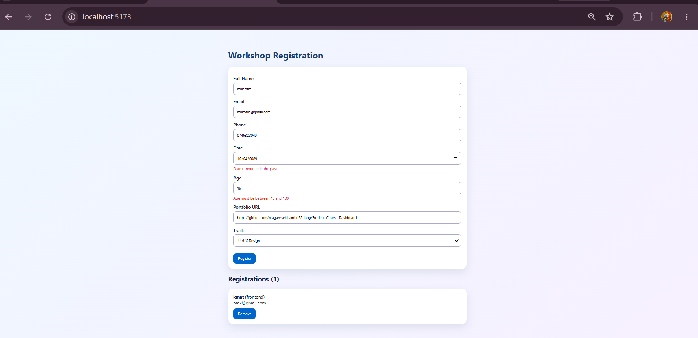
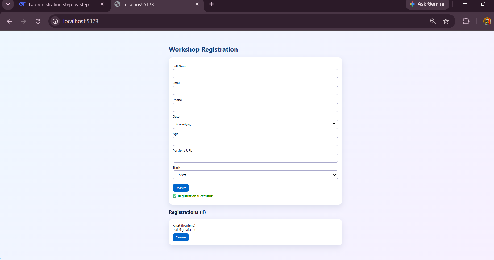

# Interactive Workshop Registration

A React application for registering for workshops. Built for Lab 2.

## Setup Instructions
1. Run `npm install` to install dependencies.
2. Run `npm run dev` to start the development server.
3. Open the local URL in your browser.

## Features
- Fully controlled inputs (text, email, tel, date, number, url, select).
- Immutable array updates (add and remove registrations).
- Clear per-field validation errors.
- Accessible and responsive UI.

## Screenshots

